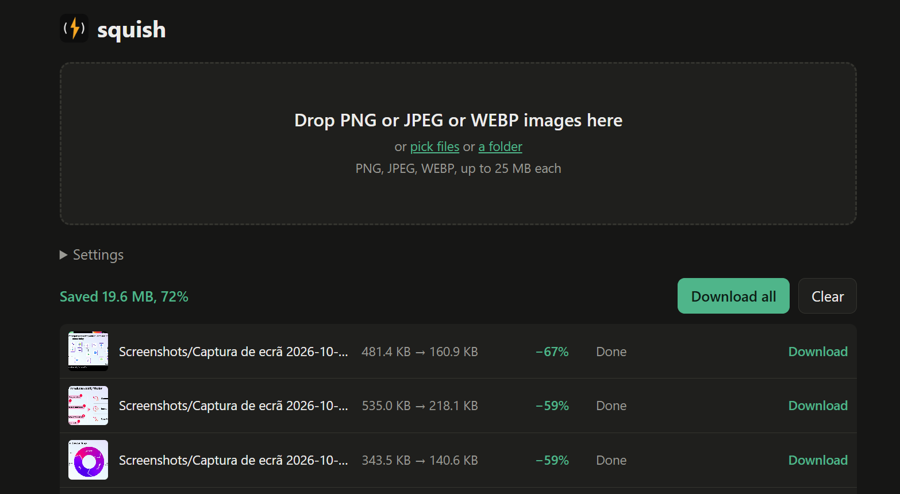

<p align="center">
  
</p>

<h1 align="center">squish</h1>

A fast, local image compressor in the spirit of [TinyPNG](https://tinypng.com). Give it PNG, JPEG or WebP files and get smaller files back in the same format. Use it as a CLI, or run `squish serve` to get a web page where you can drop images and download the results one by one or as a zip.

It's written in Rust and ships as a single binary with no runtime dependencies.

<p align="center">
  
</p>

> **Status:** the CLI and the web UI compress PNG, JPEG and WebP. Read the [PRD](prd.md) for the full plan and [`docs/adr/`](docs/adr/README.md) for the decisions behind it.

## Install

Prebuilt archives live on the [releases page](https://github.com/idarciooliveira/squish/releases):
`squish-<target>.tar.gz` (Linux, macOS) and `squish-<target>.zip` (Windows),
plus `SHA256SUMS`. Linux and macOS can install with one line:

```sh
curl -fsSL https://raw.githubusercontent.com/idarciooliveira/squish/main/install.sh | sh
```

That detects your platform, downloads the matching archive for the latest
release, and installs `squish` into `~/.local/bin`. Options:

```sh
curl -fsSL .../install.sh | sh -s -- --to ~/.local/bin --version v0.1.0
SQUISH_VERSION=v0.1.0 SQUISH_BINDIR=~/.local/bin ./install.sh
```

On Windows download the zip from the releases page and put `squish.exe` on `PATH`.

## Usage

```sh
cargo build --release                # binary at target/release/squish

squish photo.jpg                     # writes photo.min.jpg next to it
squish ./images -r -o ./out          # a whole folder, recursively, mirrored into ./out
squish ./images --in-place --yes     # replace the originals
squish - < in.png > out.png          # stdin to stdout
squish ./images --zip squish.zip     # everything into one zip
squish serve --open                  # web UI on http://127.0.0.1:8080
```

`squish serve` only listens on localhost unless you pass `--host 0.0.0.0`. The page and the HTTP API it calls are described in [ADR-0018](docs/adr/0018-http-api.md):

```sh
curl --data-binary @photo.png 'http://127.0.0.1:8080/api/compress?effort=fast' -o small.png
```

`squish --help` lists every flag. [ADR-0019](docs/adr/0019-cli-design.md) has the rules for which files a folder walk picks up, where outputs go and what the exit codes mean.

## Benchmark

Same 5 files (1.8 MB mixed PNG/JPEG) through both tools, timed with `bench/scripts/cli-speed.sh` on 2026-10-15 (i5-1335U, 12 threads, squish 0.1.0):

| Tool | Output | Wall time |
|---|---|---|
| squish (default effort) | 0.7 MB (-61%) | 0.8 s |
| squish (`--effort fast`) | 0.8 MB (-55%) | 0.2 s |
| TinyPNG API (upload + server + download, sequential) | 0.8 MB | ~33 s |

That is ~40x faster at default effort (~200x with `--effort fast`) on identical inputs. The TinyPNG leg is the public API (`shrink` POST + result download per file, +1 s pause between files, same as `bench/scripts/tinypng-baseline.sh`); it includes network and server-side queueing, so it varies with connection and load.

Full local corpus for scale: 77 files, 65.5 MB -> 24.0 MB (-63%) in ~23 s at default effort, ~6 s with `--effort fast` (30.3 MB out). No full-corpus TinyPNG timing — that would be 77 sequential API roundtrips; the 5-file sample above is the head-to-head.

Quality parity is tracked separately by the NFR-1 harness (`bench/harness`), not by this stopwatch. Reproduce locally (TinyPNG needs `TINIFY_API_KEY`, one API credit per sampled file, so keep N small):

```sh
bench/scripts/cli-speed.sh --tinypng-sample 5 bench/images
```

## Docker

The image holds only the static musl binary (`FROM scratch`, nothing else inside).
It is `linux/amd64` (the binary is `x86_64-unknown-linux-musl`).
`squish serve` binds to localhost by default, so the image passes `--host 0.0.0.0` to publish the port ([ADR-0014](docs/adr/0014-local-first-deployment.md)):

```sh
docker build -t squish .
docker run -p 8080:8080 squish   # web UI on http://127.0.0.1:8080
```

## Contributing

Turn on the repository's git hooks after cloning:

```sh
git config core.hooksPath .githooks
```

Commit messages are one line, and the owner is the only author. See [ADR-0015](docs/adr/0015-commit-policy.md).
